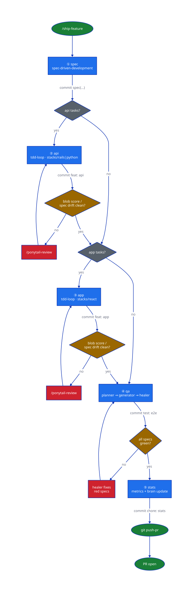

# AI Project Boilerplate

**Spec to shipped PR, one gated commit per layer — driven by Claude Code, not chained by hand.**

GitHub template for new projects with the full Claude Code AI-first development workflow: skills, agents, hooks, scripts, brain vault, and docs structure.

---

## Table of contents

- [What's included](#whats-included)
- [Requirements](#requirements)
- [Starting a new project](#starting-a-new-project)
- [Standard workflow](#standard-workflow)
- [Skills reference](#skills-reference)
- [Agents reference](#agents-reference)
- [Brain vault](#brain-vault)
- [Feature tickets](#feature-tickets)
- [Metrics and productivity tracking](#metrics-and-productivity-tracking)
- [E2E testing](#e2e-testing)
- [Commands reference](#commands-reference)

---

## What's included

| Category | What |
|----------|------|
| **Skills** | `driver` (orchestrator, `/ship-feature`), `spec-driven-development`, `tdd-loop`, `e2e`, `churn`, `code-review`, `graphify`, `obsidian-integration` |
| **Agents** | `playwright-test-planner`, `playwright-test-generator`, `playwright-test-healer` |
| **Scripts** | `bootstrap`, `metric-logger`, `push-pr`, `create-pr`, `graphify-update`, `token-estimator` |
| **Plugins** | `ponytail` — refactor pass the driver calls when a function gets too long |
| **Brain vault** | Obsidian-compatible KB at `brain/` with 8 folders |
| **Hooks** | PreToolUse metric logging, PostToolUse token estimation |
| **Docs** | E2E harness guide, design mockup folders, metrics baseline, D2 diagram sources |

---

## Requirements

| Tool | Why | Install |
|------|-----|---------|
| [Claude Code](https://claude.ai/claude-code) | The AI engine | See site |
| [gh CLI](https://cli.github.com/) | PR creation | `brew install gh && gh auth login` |
| Python 3 | Hook scripts, metric-logger, graphify | `brew install python` |
| Node.js | Playwright MCP server | `brew install node` |
| graphify | Codebase knowledge graph | `uv tool install graphifyy` (or `pipx install graphifyy`) |
| @playwright/mcp | Browser agents | `npm install -g @playwright/mcp` |
| [d2](https://d2lang.com) | Optional — only to regenerate `docs/diagrams/*.svg` | `brew install d2` |

---

## Starting a new project

### 1. Create the repo from the template

```bash
gh repo create my-project --template <org>/boilerplate --private
cd my-project
```

### 2. Run bootstrap

```bash
make bootstrap PROJECT=my-project
```

Bootstrap does:
1. Replaces every `my-project` placeholder in `CLAUDE.md`, `README.md`, and `brain/CLAUDE.md`
2. Configures the `git push-pr` alias
3. Checks graphify is installed — prints install command if not
4. Checks the Playwright MCP server is available — prints install command if not

### 3. Describe your project structure

Edit `CLAUDE.md` — replace the example `apps/`, `services/` structure with your actual directories. Claude reads this at the start of every session.

### 4. Configure stack skills (optional)

If your project uses Rails, React, or Python, the matching stack skill is auto-loaded when Claude works in those directories. To add a custom stack skill:

```
.claude/skills/<your-stack>/SKILL.md
```

### 5. Initialize graphify

Bootstrap runs this automatically. If graphify wasn't installed at bootstrap time, run it once manually after installing:

```bash
make graphify-init
```

After that, the knowledge graph updates automatically on every `git commit` via the post-commit hook bootstrap installed.

### 6. Add the Playwright MCP to Claude Code settings

In `.claude/settings.json`, add the MCP server so the E2E agents have browser access:

```json
{
  "mcpServers": {
    "playwright-test": {
      "command": "npx",
      "args": ["@playwright/mcp@latest", "--isolated"]
    }
  }
}
```

---

## Standard workflow

Say `/ship-feature` and the `driver` skill runs all five layers below, gating between each one on `ai_blob_score` / `spec_drift` and leaving one clean commit per layer:

```
1. spec   → spec-driven-development  (creates Feature ticket + spec doc)
2. api    → tdd-loop                 (backend-contract tasks: endpoints, schemas, jobs)
3. app    → tdd-loop                 (UI/consumer tasks; mockup via frontend-design first if needed)
4. qa     → e2e agents               (plan → generate → heal if red)
5. stats  → /save + git push-pr      (brain + metrics, then one PR for the branch)
```

Each layer can still be run on its own by loading its skill directly — the driver is the default path for shipping a whole feature, not the only one.

### Full flow, visually



🔵 layer (runs a skill) · 🟠 gate (`ai_blob_score`/`spec_drift` check) · 🔴 refactor loop · 🟢 start/end. The api and app gates are identical — same thresholds, same `/ponytail-review` escape hatch. The qa gate differs: a red spec goes to the healer, not to ponytail.

Source: `docs/diagrams/driver-flow.d2`. Regenerate after changing it: `d2 docs/diagrams/driver-flow.d2 docs/diagrams/driver-flow.svg`.

**What happens automatically — no manual steps needed:**

| What | When | Where |
|------|------|-------|
| graphify knowledge graph update | every `git commit` | `graphify-out/` |
| session metrics report | every `/save` | `brain/Metrics/session-*.md` |
| AI vs human comparison | `/save` when a feature is shipped | `brain/Metrics/<feature>-comparison.md` |

### How to start a feature

Tell Claude `/ship-feature [description]` and the driver runs the 5 layers above end-to-end.

To do just one layer by hand instead — say, only the spec — load that skill directly: "I want to build [feature]. Load spec-driven-development."

### How to continue after a session ends

Claude reads `brain/Features/<feature>.md` to recover context — status, completed tasks, wikilinks to decisions made. You don't need to re-explain the feature; just open Claude Code and say "continue with `<feature>`".

---

## Skills reference

Skills are markdown files in `.claude/skills/`. Claude loads them on demand with the `Skill` tool. They modify Claude's behavior for that task.

### `driver`

**Trigger:** `/ship-feature` — the default way to ship a whole feature. See [Standard workflow](#standard-workflow) above for the 5 layers and the gate between them.

Full mechanics (resuming a feature mid-flight, parallelization within a layer, skipping layers that don't apply) in `.claude/skills/driver/SKILL.md`. Run a layer's own skill directly instead when you only need that one piece, not the whole feature.

---

### `spec-driven-development`

**Trigger:** start of any new feature.

Creates two artifacts in parallel:
- **Feature ticket** at `brain/Features/<feature>.md` — persistent tracker (status, tasks, wikilinks)
- **Spec doc** at `docs/superpowers/specs/YYYY-MM-DD-<feature>.md` — detailed use cases and task breakdown

**Task format:**
```
- [ ] T1.1 — implement JWT refresh endpoint | Stack: rails | Size: M | Human: 4h
```

`Human: Xh` is the human time estimate used by the churn skill for AI vs human comparison. Always fill it in — it takes 5 seconds and enables productivity tracking.

Supported estimate formats: `4h`, `1.5h`, `30m`, `2d` (days = 8h each).

**After every task turns green:**
```bash
scripts/metric-logger.sh task T1.1 green 4h
```

**After all stages are done:**
```bash
make churn-report FEATURE=<feature-name>
```

---

### `tdd-loop`

**Trigger:** implementation phase, per task.

Runs the red → green → commit loop for one task at a time. Loads the matching stack skill automatically based on the file path.

**Parallelization:** when two or more tasks in the same stage target different stacks (rails ≠ react ≠ python), Claude spawns independent agents with their own worktrees:

```
Stage 1:
  T1.1 Stack: rails  ─┐
  T1.2 Stack: react  ─┤→ parallel agents
  T1.3 Stack: python ─┘
```

Sequential otherwise (same stack, or one task depends on another's output).

---

### `e2e`

**Trigger:** before any E2E / Playwright work.

Orchestrates the three Playwright agents. Load this skill when you need to write or fix E2E tests — it explains the pipeline, conventions, and how to invoke each agent.

See [E2E testing](#e2e-testing) for the full setup.

---

### `churn`

**Trigger:** `/churn` or "productivity analysis".

Reads all `docs/metrics/features/*.json` and generates an HTML artifact with:
- **Summary tiles** — total hours saved, total USD saved, average speed multiplier, number of features measured
- **Chart 1** — AI hours vs human estimated hours per feature (grouped bar)
- **Chart 2** — AI token cost vs human dev cost in USD per feature (grouped bar)
- **Chart 3** — Speed multiplier per feature (horizontal bar, color-coded)
- **Raw data table** at the bottom

The artifact is published to claude.ai so you can share it with your team.

---

### `graphify`

**Trigger:** before touching any existing module, or when answering "what does X do / where is Y defined".

Queries the codebase knowledge graph built by graphify (package: `graphifyy`). Run before coding to understand what exists, avoid duplication, and find the right extension points.

```bash
# Common queries
make graphify-update                # rebuild the graph after code changes
```

Inside Claude, the skill runs:
```bash
graphify query "<topic>"
graphify explain "<ModuleName>"
```

---

### `code-review`

**Trigger:** after a PR, or `/code-review`.

Reviews changed files against the spec, stack conventions, and quality thresholds:
- `spec_drift` — code outside the spec's scope
- `ai_blob_score` — functions > 40 lines without tests
- Security patterns, test coverage, and architecture consistency

---

### `obsidian-integration`

**Trigger:** reading or writing the brain vault directly.

Handles note creation with correct frontmatter, wikilinks, and zettelkasten conventions. Used internally by `/save` and the SDD skill.

---

## Agents reference

Agents live in `.claude/agents/`. They are autonomous sub-agents with restricted toolsets and isolated context — each starts fresh, uses only the tools it needs, and can run in parallel.

**Why agents instead of skills for E2E?** Each phase needs a different toolset. The planner needs browser exploration tools. The generator needs Write/Edit to produce code. The healer needs debug tools. Skills share the parent's context and tools; agents are isolated.

### `playwright-test-planner`

**When to use:** a new feature shipped and needs E2E coverage, or you want to audit gap coverage on an existing feature.

**What it does:**
1. Reads the frontend source (Grep/Glob/Read)
2. Navigates the live app in a real browser
3. Maps all flows: happy path, error states, empty states, URL state, browser-back behavior
4. Writes a structured plan to `tests/e2e/specs/<feature>/<feature>-test-plan.md`
5. Writes a QA checklist to `tests/e2e/specs/<feature>/checklists/`

`tests/e2e/specs/` is **gitignored** — plans are scratch artifacts, not committed docs.

**Invoke:**
> "Plan E2E tests for the [feature] page."

---

### `playwright-test-generator`

**When to use:** after the planner has produced a plan.

**What it does:**
1. Reads the plan
2. Drives each scenario in a real browser using the Playwright MCP
3. Writes `.spec.ts` files to `tests/e2e/tests/<feature>/`
4. Creates or extends `tests/e2e/drivers/<feature>.ts` (locators and actions, never in the spec)

**Conventions enforced:**
- Test titles follow `TC-NN <short description>`
- Locators: `data-testid` first, then ARIA roles, then text — never CSS selectors
- No `test.only`, no `waitForTimeout(ms)`
- Each test seeds and cleans up its own data

**Invoke:**
> "Generate the [feature] specs from the plan at tests/e2e/specs/[feature]/[feature]-test-plan.md"

---

### `playwright-test-healer`

**When to use:** CI goes red, or a spec breaks after a frontend change.

**What it does:**
1. Lists failing tests
2. Attaches to each failing test in debug mode
3. Root-causes the failure: selector drift, timing race, state leak, or genuine app bug
4. Makes surgical edits — only touches the failing test and its driver; never rewrites passing tests
5. Marks genuine app bugs with `test.fixme(...)` instead of weakening assertions

**Invoke:**
> "tests/e2e/tests/[feature]/[spec].spec.ts is failing, fix it."

---

## Brain vault

The vault at `brain/` is an Obsidian-compatible knowledge base that persists context across sessions. Claude reads it at the start of each session to recover where you left off.

| Folder | What goes there |
|--------|----------------|
| `Features/` | One note per feature — the ticket system |
| `Architecture/` | System overview, service boundaries, data flow diagrams |
| `Codebase/` | Conventions, patterns, key modules, known gotchas |
| `Database/` | Schema, relationships, indexes, migration notes |
| `Install/` | Local setup steps, required env vars, dependency notes |
| `Decisions/` | ADRs — the *why* behind non-obvious choices |
| `APIs/` | External integrations, auth methods, rate limits, gotchas |
| `Infra/` | Docker, Terraform, CI/CD, environment configs |
| `Runbook/` | Deploy steps, rollback procedure, production debug guide |

### `/save`

Tell Claude `/save` after any session that changed something worth remembering. Claude will:
1. Identify which brain folders are affected
2. Update (or create) the relevant notes with wikilinks
3. `git commit` — no push (you push)

### Vault rules

- Use wikilinks: `[[note-name]]` not markdown links
- Every note has YAML frontmatter (`title`, `tags`, `created`, `updated`, `status`, `type`)
- Filenames in kebab-case: `auth-flow.md`
- Minimum 2 wikilinks per note
- **Never write secret values** — references only, never actual tokens/passwords

---

## Feature tickets

`brain/Features/` is the project's ticket system. One note per feature, lifecycle:

```
draft → ready → in-progress → shipped → archived
```

Each ticket contains:
- Summary of what the feature does and why
- Actors
- Acceptance criteria
- Task list (copied from the spec stages, with `Human: Xh` estimates)
- Wikilinks to ADRs created during the feature
- Wikilinks to Architecture/Codebase/Database notes touched

The ticket is **created by the SDD skill** when you start a feature, and **updated by Claude** each time a task is completed or `/save` is run.

---

## Metrics and productivity tracking

### How metrics work

**Everything is automatic.** The only manual input is `Human: Xh` on each task in the spec — the human time estimate that powers the AI vs human comparison.

When Claude completes a task it logs it internally. When you say `/save`:
1. Claude runs `scripts/metric-logger.sh report` → saves `brain/Metrics/session-YYYY-MM-DD-<branch>.md`
2. If a feature was shipped this session → also runs `scripts/metric-logger.sh feature-report <feature>` → saves `brain/Metrics/<feature>-comparison.md`

### Visualize with `/churn`

```
/churn
```

Reads all feature reports from `brain/Metrics/` and publishes an HTML artifact with comparison charts. Run it any time — share the link with your team.

### What the session report contains

| Metric | What it measures |
|--------|-----------------|
| `graphify_calls` | graph queries during the session |
| `brain_docs_read` | vault notes consulted |
| `tasks_completed` | spec tasks completed / total |
| `ai_blob_score` | functions > 40 lines without tests (alert if > 20) |
| `spec_drift` | code outside the spec's scope (alert if > 10%) |
| `cost.total_usd` | AI token cost by model |

### Model routing (cost optimization)

| Phase | Model | Why |
|-------|-------|-----|
| Spec writing | Opus | Deep business reasoning |
| Graphify context queries | Haiku | Read-only, fast |
| TDD red→green | Sonnet | Fast iteration |
| Refactor | Sonnet | Mechanical |
| Code review | Sonnet | Multi-file reasoning |
| E2E planning/generation/healing | Sonnet | Browser + code |

---

## E2E testing

### Setup (once per project)

**1. Add Playwright MCP to Claude Code settings** (in `.claude/settings.json`):
```json
{
  "mcpServers": {
    "playwright-test": {
      "command": "npx",
      "args": ["@playwright/mcp@latest", "--isolated"]
    }
  }
}
```

**2. Install Playwright in the project:**
```bash
cd tests/e2e
npm install
npx playwright install chromium
```

**3. Create `tests/e2e/.env.local`:**
```bash
BASE_URL=http://localhost:3000
API_URL=http://localhost:8080
ADMIN_EMAIL=admin@test.local
ADMIN_PASSWORD=<test-password>
```

**4. Bootstrap the test stack** (seeds admin user and global data):
```bash
cd tests/e2e && npx playwright test --project=setup
```

### The three-agent pipeline

```
Feature ships
     │
     ▼
playwright-test-planner      "Plan E2E tests for the X page"
  └── writes tests/e2e/specs/<feature>/<feature>-test-plan.md
     │
     ▼
playwright-test-generator    "Generate specs from the plan at ..."
  └── writes tests/e2e/tests/<feature>/*.spec.ts
  └── writes tests/e2e/drivers/<feature>.ts
     │
     ▼
CI runs
  ├── green → done
  └── red ──▶ playwright-test-healer   "[spec].spec.ts is failing, fix it"
```

### Directory structure

```
tests/e2e/
  bootstrap/global.setup.ts   ← seeds global state
  drivers/<feature>.ts        ← locators + actions + dispose (AI-owned)
  fixtures/auth.ts            ← authedPage fixture
  helpers/auth.ts             ← newAdminContext(browser)
  helpers/common.ts           ← authToken, watchConsole, seederUrl
  specs/                      ← gitignored: plans + checklists
  testdata/                   ← static payloads
  tests/<feature>/*.spec.ts   ← committed specs
  playwright.config.ts
```

### Running tests

```bash
cd tests/e2e

npx playwright test                              # all tests
npx playwright test tests/<feature>/             # one feature
npx playwright test -g "TC-01" --project=chromium  # one test by title
npx playwright test --last-failed --project=chromium  # replay failures
npx playwright test --headed --project=chromium  # with browser UI
```

---

## Commands reference

```bash
# Setup
make bootstrap PROJECT=my-project     # one-time project initialization

# Graphify
make graphify-init                    # build knowledge graph (once per sub-project)
make graphify-update                  # rebuild after code changes

# Metrics
make metrics-report                   # session metrics → docs/metrics/session-*.json
make churn-report FEATURE=name        # AI vs human → docs/metrics/features/name.json

# PR
git push-pr                           # push branch + create one PR, metrics in the body

# Metric logging (used by Claude and manually)
scripts/metric-logger.sh task T1.1 green 4h          # log a completed task with human estimate
scripts/metric-logger.sh cost sonnet 12000 4000       # log token usage
scripts/metric-logger.sh graphify "query:auth"        # log a graphify call
scripts/metric-logger.sh report                       # generate session report
scripts/metric-logger.sh feature-report my-feature   # generate feature report
```

### Slash commands (inside Claude Code)

| Command | What it does |
|---------|-------------|
| `/ship-feature` | Run the `driver` — spec → api → app → qa → stats, one commit per layer |
| `/save` | Update brain vault with current session's work and `git commit` |
| `/churn` | Generate AI vs human productivity artifact across all features |
| `/code-review` | Review current branch against spec and coding standards |
| `/e2e` | Load E2E skill and start the Playwright agent pipeline |
| `/ponytail [lite\|full\|ultra\|off]` | Set the refactor-pass intensity the driver's gate calls on `ai_blob_score` |
| `/ponytail-review` | Review a diff like a senior dev — called by the driver's gate, or on its own |
